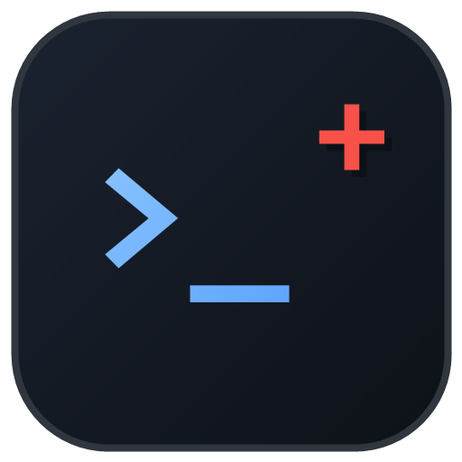

<div align="center">
  >
  <h1>CodePlus</h1>
  <p><strong>把「AI 怎么参与工程」变成可版本化、可验证、可重建的资产</strong></p>
  <p>
    <a href="LICENSE"></a>
    
    
    
    
  </p>
</div>

> **两个模块，严格分离：**
> Codex 全局环境（`codex/` + `docs/`）与项目级 AI 环境技能（`skills/`）互不引用——
> 全局指南不出现 skill，skill 文档不出现全局协调层、`agents/*.toml` 或全局 AGENTS.md。
> 需要跨模块协同时，由仓库索引（本文件）负责指路，而不是让两边互相渗透。

CodePlus 存放的不是可运行产品，而是**工程环境本身**：换机器、重装、复盘决策时，从这里还原。

---

## ✨ 特性

- **可版本化**：`~/.codex/AGENTS.md`、五个子代理 TOML、完整配置指南都进仓库，改动可 diff、可回溯。
- **双向同步**：live → 仓库快照（`sync-*`）、仓库 → live 安装（`install-*`），两侧写入前都有备份。
- **机器判定**：19 条跨文件规则 + 4 项附加检查（TOML 占位符 / 指南纯度 / 实证表述 / 版本日期），不靠"看起来对"。
- **一条命令自检**：`verify-repo.ps1` 覆盖 BOM、可编译、字节码残留、文档链接、快照一致、安装计划、哈希对齐。
- **两个项目技能自包含**：初始化项目 AI 环境（契约、文档权威、产物基准、检查器），自带 9 / 11 个测试。
- **收益有据可查**：多 Agent 方案的收益分析与其复现脚本一并入库（`docs/` + `tools/analysis/`）。

## 🧩 两个严格分离的模块

| 模块 | 内容 | 目录 | 同步（live → 仓库） | 安装（仓库 → live） |
| --- | --- | --- | --- | --- |
| **Codex 全局环境** | 全局协调层、五个子代理、配置指南、一致性规则 | [`codex/`](codex/) · [`docs/`](docs/CODEX-SETUP.md) | `tools/sync-config.ps1` | `tools/install-codex-env.ps1` |
| **项目 AI 环境技能** | `project-ai-environment`（通用）· `unity-ai-environment`（Unity） | [`skills/`](skills/) | `tools/sync-skills.ps1` | `tools/install-skills.ps1` |

**边界约定**：`docs/CODEX-SETUP.md` 与 `codex/` 只讲全局环境；`skills/` 只讲项目级环境。
任何跨模块内容都属于仓库索引或工具脚本，不写进任一模块的规则正文。

## 🚀 快速开始

### 1）改完配置，快照进仓库

```powershell
# 全局环境（先预览，再写入）
powershell -NoProfile -File D:\ProjRx\CodePlus\tools\sync-config.ps1 -Preview
powershell -NoProfile -File D:\ProjRx\CodePlus\tools\sync-config.ps1

# 项目技能（改了 ~/.codex/skills 之后）
powershell -NoProfile -File D:\ProjRx\CodePlus\tools\sync-skills.ps1
```

### 2）换机器 / 重装，从仓库还原

```powershell
# 先按 docs/CODEX-SETUP.md §3.2 手写 <HOME>\.codex\config.toml（含机器特定 MCP 路径，不入库）
powershell -NoProfile -File D:\ProjRx\CodePlus\tools\install-codex-env.ps1 -Apply
powershell -NoProfile -File D:\ProjRx\CodePlus\tools\install-skills.ps1 -Apply
# 重启 Codex 生效
```

### 3）给某个项目装 AI 环境

- 通用项目：`skills/project-ai-environment` — 生成 `Docs/ai/` 规则、意图契约、文档权威、产物基准与 `tools/ai/contract_check.py`。
- Unity 工程：`skills/unity-ai-environment` — 通用底座 + Unity 专属验收（资源/.meta、程序集、策划源表、设备）。

两个技能都随包自带资产与测试，初始化后跑 `python tools/ai/check_env.py check` 验证。

## 📂 目录结构

```
CodePlus/
├── assets                         ← 项目 logo
├── docs/
│   ├── CODEX-SETUP.md             ← 主指南：角色/委派/配置/校验/踩坑/复原
│   ├── CODEX-AGENTS-TEMPLATES.md  ← 五个子代理完整正文（脚本生成）
│   └── CODEX-MULTIAGENT-BENEFIT.md← 多 Agent 收益分析与局限
├── codex/
│   ├── AGENTS.global.md           ← 全局协调层（= ~/.codex/AGENTS.md）
│   └── agents/*.toml              ← 五个正式子代理文件（= ~/.codex/agents/*.toml）
├── skills/
│   ├── project-ai-environment/    ← 通用项目 AI 环境生成器
│   └── unity-ai-environment/      ← Unity 项目 AI 环境生成器
└── tools/
    ├── sync-config.ps1  install-codex-env.ps1    ← 全局环境双向
    ├── sync-skills.ps1  install-skills.ps1       ← 项目技能双向
    ├── sync-guide.py  check-consistency.py       ← 指南生成 / 规则一致性
    ├── verify-repo.ps1  check-links.py           ← 本机一致性 / 链接检查
    └── analysis/                                  ← 收益分析复现脚本
```

## ✅ 校验

```powershell
# 若报 "not digitally signed"，在命令中加 -ExecutionPolicy Bypass
powershell -NoProfile -ExecutionPolicy Bypass -File D:\ProjRx\CodePlus\tools\verify-repo.ps1   # 本机一致性（依赖 ~/.codex）
python -X utf8 D:\ProjRx\CodePlus\tools\check-consistency.py           # 跨文件规则
```

`verify-repo.ps1` 的 8 项检查：

| # | 检查 | 失败含义 |
| --- | --- | --- |
| 1 | PowerShell 脚本 UTF-8 BOM | PowerShell 5.1 会把中文按 GBK 误读 |
| 2 | Python 可编译 | 语法错误 |
| 3 | 无 `__pycache__` / `*.pyc` | 字节码残留（bootstrap 已设 `dont_write_bytecode`） |
| 4 | 文档相对链接 | 链接失效 |
| 5 | live → 指南快照一致 | 改了 live 未同步 |
| 6 | 仓库 → live 安装计划为空 | 仓库比 live 新，需安装 |
| 7 | `codex/` 与本机哈希一致 | 快照过期 |
| 8 | 两个 skill 双向一致 | 技能漂移 |

> **它依赖本机 `~/.codex`。** 新克隆/新机器请先 `install-* -Apply` 再验证；
> 不要把它接进没有 live 配置的 CI（必然红）。

## 🧭 约定

- **PowerShell 脚本保存为 UTF-8 with BOM**；Python 一律 `python -X utf8`，只用标准库。
- **生成区不要手改**：指南 §3.1、§4 表格、`docs/CODEX-AGENTS-TEMPLATES.md`、`codex/` 快照。
- 改配置的顺序：先改 live（`~/.codex/...` 或 skill 目录）→ 跑对应 `sync-*` → 再校验。
- 仓库不放凭据、`auth.json`、会话日志、数据库与备份产物（`.gitignore` 已覆盖）。

## ⚠️ 已知限制

- `config.toml` 不入库（机器特定 MCP 路径），新机器必须手写。
- 子代理档位、沙箱与运行时加载无法静态证明，需重启 Codex 后实测。
- `*sync-*` / `install-*` 的 skill 镜像用 `robocopy /MIR`：会覆盖目标侧差异，靠写入前备份兜底。
- `install` 不删除 live 独有的 `agents/*.toml`；而快照会把它带进仓库——发现实验 agent 时先清理。
- 收益分析数字来自特定时间段的会话，只代表「当时本机」，不外推。

## 📄 License

[Apache License 2.0](LICENSE)

本项目以 Apache License 2.0 授权，法律文本以 [`LICENSE`](LICENSE) 为唯一准据。
